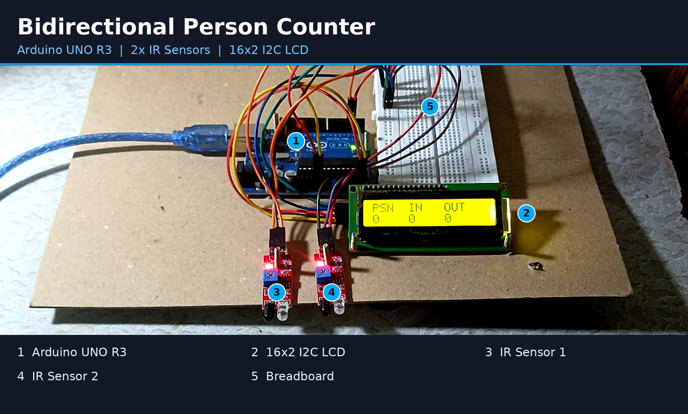
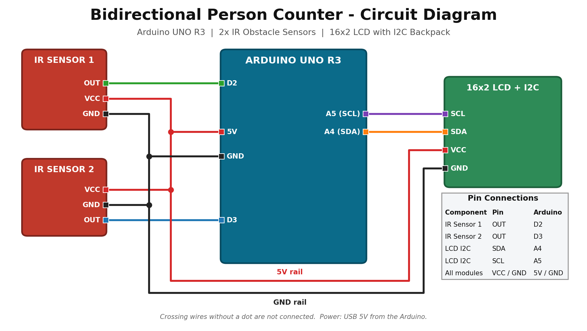

# Bidirectional Person Counter using Arduino
   
A low-cost room occupancy counter for classrooms and labs. It detects people
entering and leaving through a door and shows the live count on an LCD.

## Features
- Counts total entries and total exits
- Shows the current number of people inside the room
- Direction detection using two IR sensors
- Real-time display on a 16x2 I2C LCD

## Components Used
| Component | Quantity |
|-----------|----------|
| Arduino UNO R3 | 1 |
| IR obstacle sensor module | 2 |
| 16x2 LCD with I2C module | 1 |

## Working Principle
Two IR sensors are placed a short distance apart at the door. If sensor 1 is
triggered before sensor 2, the person is entering. If sensor 2 is triggered
first, the person is leaving. The Arduino updates the counts and shows them
on the LCD.

## Circuit Connections
   

| Component | Arduino Pin |
|-----------|-------------|
| IR Sensor 1 OUT | D2 |
| IR Sensor 2 OUT | D3 |
| LCD SDA | A4 |
| LCD SCL | A5 |
| VCC / GND | 5V / GND |

## Setup
1. Install the Arduino IDE
2. Install the `LiquidCrystal_I2C` library
3. Open the `.ino` file from the `Firmware` folder
4. Select Board: Arduino UNO, then upload

## Limitations
- Two people crossing at the same time may be miscounted
- Strong sunlight can affect IR sensors

## Future Scope
- Automatic lights and fans based on occupancy
- Cloud monitoring using ESP32
- Buzzer alert when room capacity is reached

## Author
Aniket Verma
